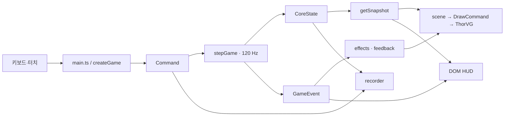

# 코드 구조

이 문서는 코드의 진입점과 책임 경계를 설명합니다. 세부 규칙은 아래 문서와 코드 가까이에 있는 README에서 확인합니다.

게임 규칙은 `src/game` 안에서 결정됩니다. 브라우저 시간, DOM, 저장소, 입력 장치, 렌더링은 코어 밖에 있습니다. 코어는 같은 시작 상태와 같은 명령에서 같은 상태와 이벤트를 만듭니다.

처음 코드를 읽는다면 [코드 읽기 안내서](../explain/README.md)에서 시작합니다. 현재 게임은 사무실, 건물, 옥상, 하늘, 궤도의 다섯 스테이지로 구성됩니다.

## 진입점

| URL | 진입 파일 | 용도 |
|---|---|---|
| `/` | `src/main.ts` | 실제 게임 |
| `/preview.html` | `src/preview.ts` | 모션을 프레임 단위로 확인 |
| `/replay.html` | `src/replay-tool.ts` | 기록된 시도를 재생하고 상태를 조사 |

Vite는 세 페이지를 함께 빌드합니다.

## 코드 영역

| 경로 | 책임 |
|---|---|
| `src/game` | 상태, 명령, 물리, 스테이지 규칙, 결정적 리플레이 |
| `src/render` | 장면 구성, ThorVG 명령 생성, 시각 효과 |
| `src/presentation` | 스테이지별 화면 메타데이터 |
| `src/preview` | 모션 장면 생성, 프레임 기록, 미리보기 자동 조작 |
| `src/ui` | 입력, HUD, 피드백, 메뉴, 리플레이 UI |
| `src/i18n.ts` | 영어와 한국어 메시지 |
| `tests` | 공개 계약, 플레이 경로, 결정성, 렌더 데이터 검증 |

## 다음 문서

- [실행 흐름](runtime.md): 페이지 초기화부터 한 프레임의 화면 출력까지
- [게임 코어](game-core.md): 상태, 명령, 고정 틱, 스테이지, 리플레이
- [프레젠테이션](presentation.md): ThorVG, Canvas2D, 효과, HUD
- [개발과 검증](development.md): 변경 위치, 테스트, 개발 페이지

세부 코어 규칙은 [`src/game/README.md`](../../src/game/README.md), 스테이지 규칙은 [`src/game/stages/README.md`](../../src/game/stages/README.md), 테스트 도구는 [`tests/support/README.md`](../../tests/support/README.md)를 기준으로 합니다.
